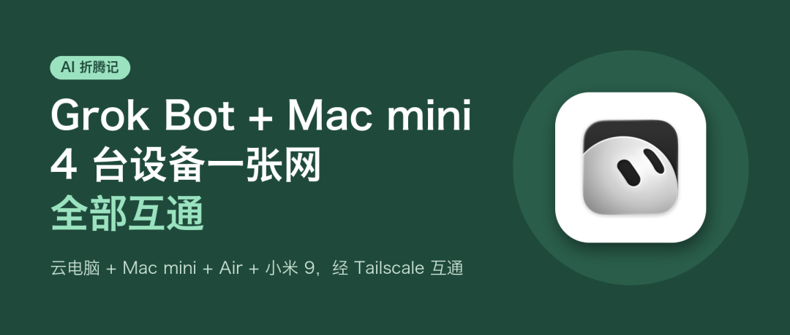
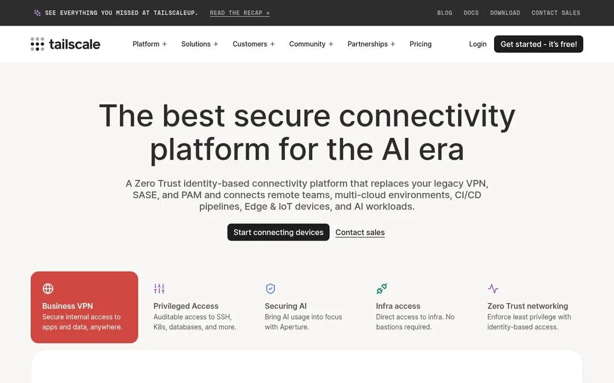
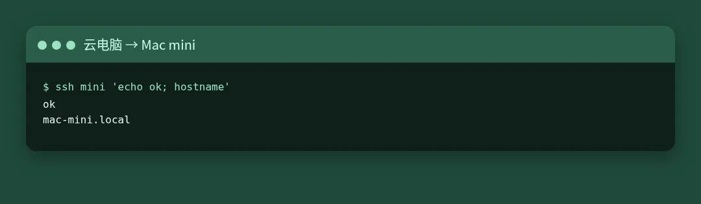
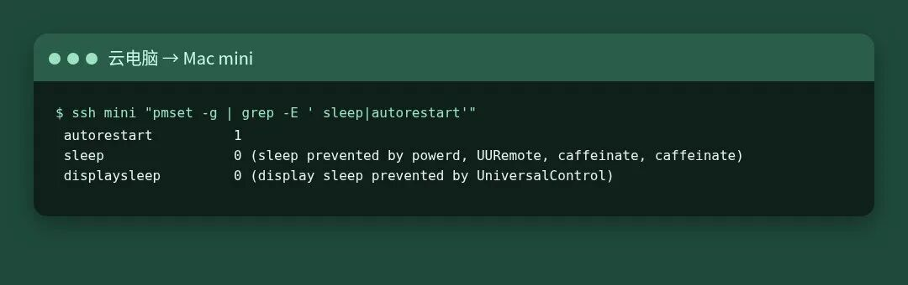
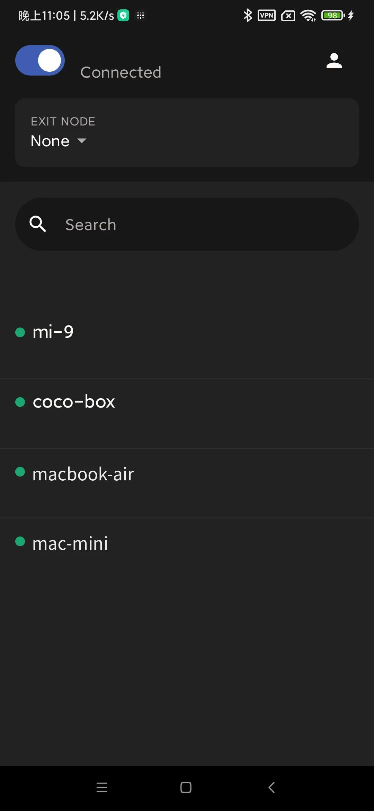
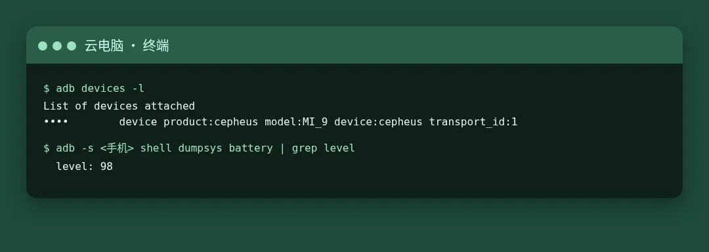
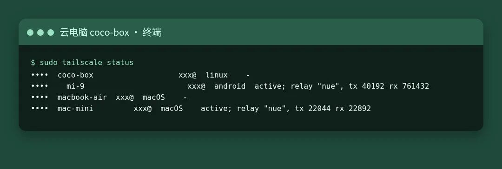
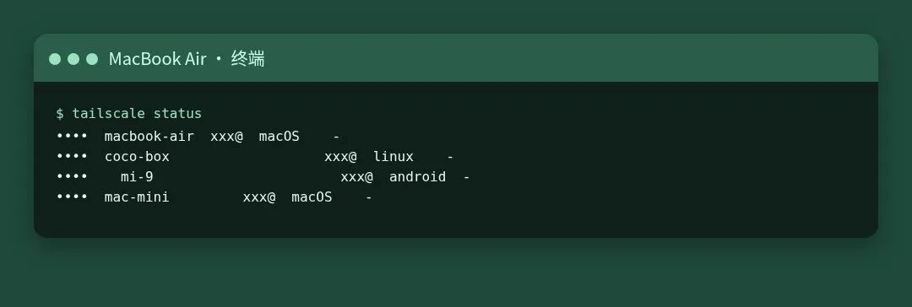
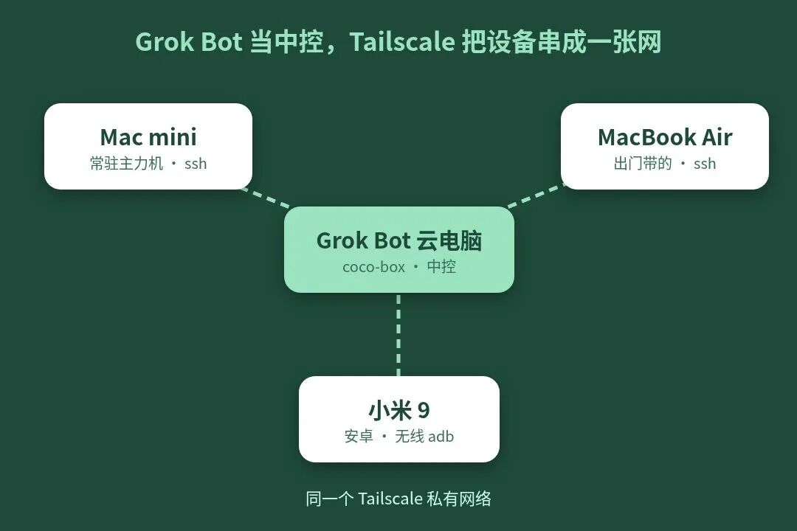

# 我用 Grok Bot 把 Mac mini、Air 和手机连成一张网：4 台设备全部互通

> ✍️ **作者:** 萌威  
> 📅 **发布时间:** 2026/10/12 23:32:35  
> 🔗 **微信原文:** https://mp.weixin.qq.com/s/4WVFT2Xn6soLXJ-jSnlzQA  
> 📦 **本地图片数:** 9 张 (已物理转存至本地 images/ 目录)

---

家里那台 Mac mini，过去一段时间一直在做些零碎的活：每天跑数据日报、记账、养号。机器常年开着，能力却大多闲置，谈不上充分利用。

转机出现在把 Grok Bot 装上 Mac mini 之后。用同一个账号登录，Mac mini、MacBook Air 和手机之间真正互通了，Mac mini 也从一台后台机器，变成了整个网络里最稳定的节点。

## 从各自为战到互相连通

之前用 OpenClaw 时，思路是在每台电脑上各装一个：Mac mini 一个，MacBook Air 一个。但这两个 OpenClaw 彼此独立，各自只能管自己所在的那台机器，没有互通。

Grok Bot 的不同之处在于，它自带一台云电脑。客户端装在各台设备上、登录同一个账号后，这台云电脑就成了天然的中控，可以同时调度多台设备。两台电脑甚至可以基于 Grok Bot 一起玩游戏，手机也能反过来操作它们。只要设备在线，无论人在哪里，都能远程使用。

## 新的问题：客户端容易掉线

连通之后，很快暴露出一个问题：Grok Bot 客户端容易掉线，远程操作时常失败。

排查下来原因有两类。一是 MacBook Air 合盖后进入睡眠，自然无法连接；二是 Mac mini 虽然没有休眠，但上面的 Grok Bot App 偶尔会掉，重新打开即可恢复。问题不复杂，但人不在家时就只能等着。

## 借鉴郭宇 @turingou 的方案：Tailscale

解决思路参考了郭宇 @turingou 的做法：在 Grok Bot 的云电脑上安装 Tailscale，再在自己的每台设备上也装上 Tailscale，并登录同一个账号。这样，所有设备就以云电脑为中心组成了一张私有网络。

Tailscale 可以理解为一张虚拟局域网，个人使用免费，支持 100 台以内的设备。

Tailscale 官网首页

网络打通后，云电脑可以直接通过 ssh 登录 Mac mini 和 MacBook Air 执行命令行。能跑命令行，可操作的空间就大了很多。

云电脑通过 ssh 登录 Mac mini

## 后续的几步完善

最初只是为了解决掉线，后来逐步完善成了现在的样子。

**设备分工。** Mac mini 接电源、不休眠，作为常驻主力机。它已经稳定运行了大半年，几乎不需要手动开机，断电恢复后会自动开机并启动常用软件。此外设置了每天 10:23 的自动巡检：一旦发现 Mac 无法连接，就从云电脑 ssh 进 Mac mini 重启 Grok Bot App。MacBook Air 作为随身设备，通过 pmset 关闭了合盖睡眠，并通过了合盖测试。

Mac mini：断电后自动重启，系统不休眠

**接入安卓手机。** 一台闲置的小米 9 也加入了网络：先通过 USB 连接 Mac mini 开启 adb，安装 Tailscale 后切换为无线 adb。现在云电脑可以远程对它截屏、唤醒、读取电量。

云电脑远程截取的小米 9 屏幕：Tailscale 里四台设备都在线（地址已打码）

云电脑通过无线 adb 连上手机，并读出电量

手机接入后，四台设备都在同一张网里

从 MacBook Air 上看，也是同一张网

由于手机无法同时运行 Tailscale 和其他 VPN，这台小米 9 干脆成了专用设备。iPhone 目前无法这样控制。

最终结构：Grok Bot 的云电脑做中控，各设备接入同一张网

## 连起来之后

设备连成一张网之后，一件事就可以在几台设备之间接力完成。

文中那张 Tailscale 设备列表的手机截图，就是这样来的：云电脑通过 adb 让小米 9 打开 App、截下屏幕，再把图拉回自己这里做遮挡处理，最后交给 MacBook Air 排进文章页面。三台设备各做一段，我一台都没碰。

类似的接力还有不少。带着 MacBook Air 在外面时，可以让云电脑 ssh 进家里的 Mac mini，把一个耗时的任务放在那里跑，跑完再把结果传回 Air。笔记本合上盖子也不影响，活一直在 Mac mini 上进行。

反过来也行。Mac mini 上改完一个网页，云电脑可以让手机打开它、截一张屏回来，在电脑上看看手机端的显示效果，用不着自己再掏出手机去点。

手机上的消息也能接进来。手机收到的通知，云电脑可以通过 adb 读出来，再交给某一台电脑接着处理，比如按通知内容去 Mac mini 上查一下对应的任务。

闲下来的时候，几台电脑还能基于 Grok Bot 凑一桌牌，云电脑当荷官发牌，Mac mini 和 Air 各自出牌。

