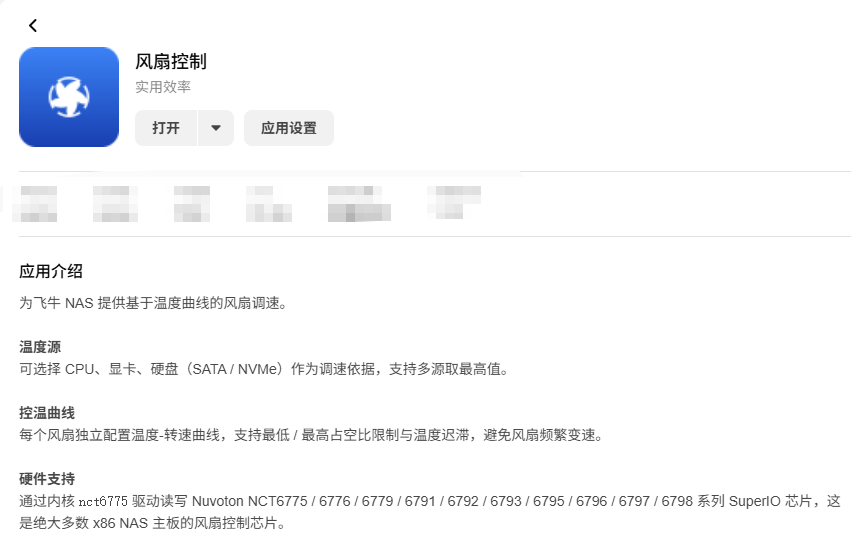
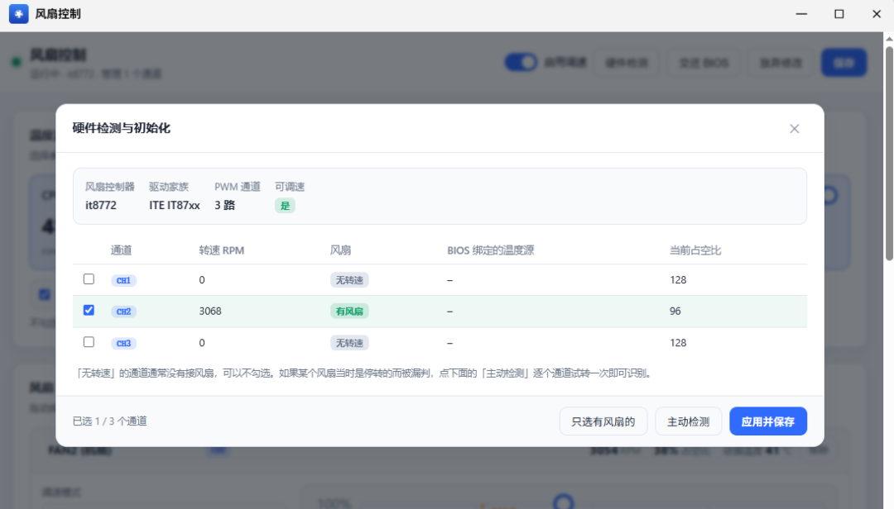
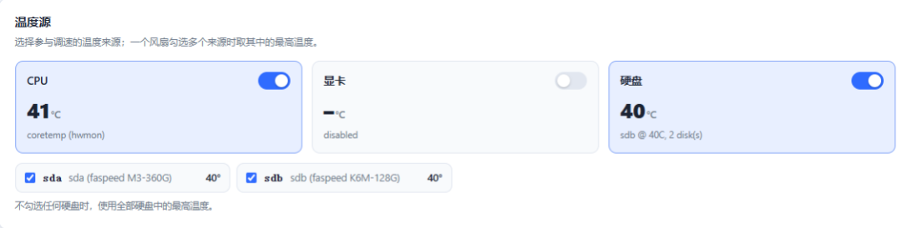
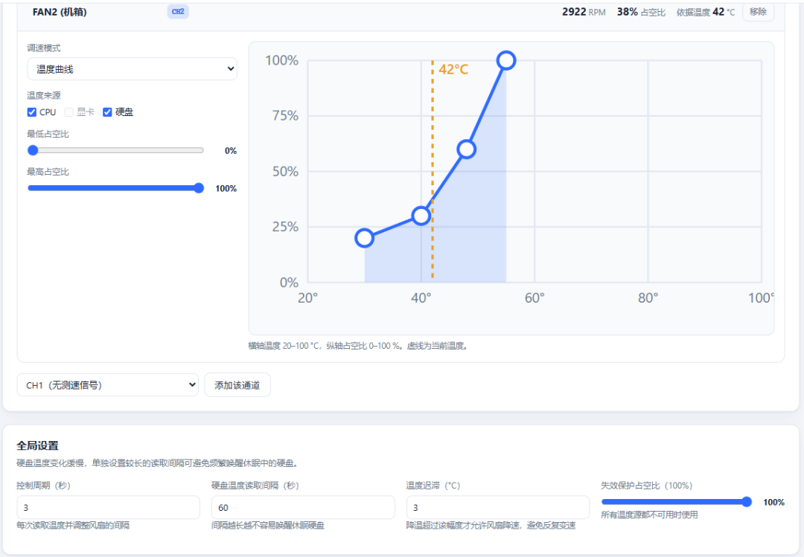

# 飞牛fnOS应用推荐：风扇控制，让风扇按温度转，而不是一直狂转

> ✍️ **作者:** 极有趣科技  
> 📅 **发布时间:** 2026/10/15 12:04:23  
> 🔗 **微信原文:** https://mp.weixin.qq.com/s/V9YOOSmfBxSEX8o9j4Lexw  
> 📦 **本地图片数:** 4 张 (已物理转存至本地 images/ 目录)

---

风扇转快点降温，转慢点安静，主板 BIOS 给你的那套策略又总是慢半拍。

**飞牛fnOS 新上的 风扇控制** 把这件事交回你手里：拿 CPU、显卡或硬盘的温度当依据，按你画的曲线自动调速，低负载安静、高负载压得住。

它是什么

它是一款**系统工具类应用**，通过 Linux 内核的 nct6775 驱动，读写主板上的 **Nuvoton NCT6775~6798 系列 SuperIO 芯片**——这类芯片是绝大多数 x86 NAS 主板用来控制风扇的芯片。应用读取温度，再按你配的曲线向风扇下发转速。

它解决的具体问题：**主板 BIOS 的风扇策略又慢又死板**——低负载时风扇还在空转（吵），高负载时又反应迟钝。风扇控制把它从「硬件行为」变成「可配置的策略」：温度 → 曲线 → 转速。

数据与配置都保存在本机、不上云。但要先说清楚：**它只支持 x86**，且主板要使用上面那类芯片；ARM 设备或风扇被 BIOS 锁死的品牌整机，它接管不了。

核心亮点

01　温度源随便挑

可拿 CPU、显卡或硬盘（SATA / NVMe）的温度作依据，还支持「多源取最高值」——让一个风扇盯住几块盘里最热的那块。

02　每个风扇一条曲线

每个风扇独立配置「温度 → 转速」曲线，而不是所有风扇一刀切，拖动曲线即可调节功能。

03　有迟滞，不抖不闹

支持最低 / 最高占空比限制与温度迟滞，防止风扇在临界温度点反复加、减速，频繁变速。

04　留底，不让风扇停

每个风扇可设最低占空比，防止转速被压到 0 导致停转、硬盘过热。

05　双重安全兜底

温度源全部失效时风扇自动升到全速保护硬件；停止或卸载应用时，所有风扇自动交还主板 BIOS 控制，不留失控风扇。

06　为飞牛而做

以飞牛应用形式上架应用中心，装完即是网页界面，不用自己写脚本、配 systemd 服务。

怎么装

1 登录飞牛 NAS 网页端，打开桌面的**应用中心**。

2 搜索 风扇控制，确认是系统工具类、架构为 **x86**，点击**安装**。

3 安装完成后打开应用，进入风扇调速界面。

4 若打开后**扫描不到风扇**，先别卸载——多半是传感器 / 驱动没就绪。

识别不到风扇？先查这两件事

· 飞牛应用中心有传感器**驱动类应用**（如 ite-it87 这一类芯片驱动），先装了再回来重新扫描。

· 确认主板是否属于 NCT6775~6798 系列、内核 nct6775 模块是否已加载。

· 驱动装好仍加不上风扇，通常是**主板 / BIOS 不支持 PWM 调速**或 PWM 线没接对——软件无法解决。

首次配置

配置速查

**温度源**　该风扇的调速依据：CPU / 显卡 / 硬盘（SATA、NVMe），或「多源取最高值」

**温度-转速曲线**　每个风扇单独设置：多少度对应多少转速

**最低 / 最高占空比**　限制转速上下限；下限别设 0，留一个「不停转」的底

**温度迟滞**　升速 / 降速之间的温差死区，避免临界点频繁变速

一条常见的曲线思路

**30℃ 以下**　约 20%~30%（安静为主）

**40℃**　约 40%

**50℃**　约 60%

**60℃ 以上**　100%（降温优先）

先按「安静优先」起步，观察几天温度再逐步收紧，**别一上来就把转速压到极低**。

适合谁

· 自己组装（DIY）的 x86 飞牛 NAS 用户，尤其是用主流台式机主板的那批人

· 被风扇常年嗡嗡转、想安静下来的家庭用户

· 硬盘仓温度偏高、想按硬盘温度而不是 CPU 温度控风的用户

· 愿意花几分钟调一条曲线、之后就不用管的人

几点提醒

**① 仅 x86，且看主板芯片。**它靠 Nuvoton NCT6775~6798 系列 SuperIO 芯片读写风扇；ARM、非该系列芯片、风扇被 BIOS 锁死的机器都用不了。

**② 停转风险要自己防。**最低占空比设到 0，风扇可能在低温时停转，温度反而失控。给每个风扇留一个「永不停止」的最低转速。

**③ 曲线别画太激进。**为了安静把整条曲线压太低，高温时可能压不住温度。高温段（60℃ 以上）建议给到 100%。

**④ 卸载后会交还 BIOS。**停用 / 卸载应用时风扇自动交还主板 BIOS 控制，这是保护机制不是故障，但也意味着卸载后策略回到 BIOS 原样。

**⑤ 换曲线后盯一两天。**涉及硬件调速，改完最好观察温度与噪音，确认没有异常再放着不管；机械硬盘仓宁可吵一点，别让硬盘长期高温。

一句话总结：**把「风扇怎么转」从 BIOS 的固定套路，变成一条你自己画的温度曲线——该静的时候静，该压的时候压。**

