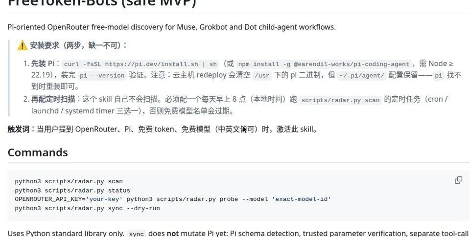
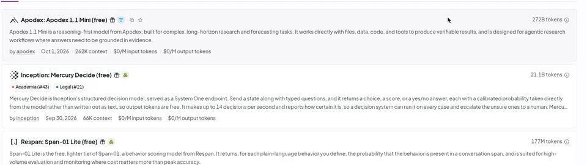

# &quot;Muse Token 永动机&quot;火了：真能无限白嫖？我把原理扒完了

> ✍️ **作者:** 赛博尝鲜局  
> 📅 **发布时间:** 2026/10/11 17:55:27  
> 🔗 **微信原文:** https://mp.weixin.qq.com/s/5D0E-n-fsyuUwEfS-kzazw  
> 📦 **本地图片数:** 4 张 (已物理转存至本地 images/ 目录)

---

 

有人宣称把 Muse 的 token 干成了"永动机"，这辈子都用不完。听起来像标题党，但原理扒完我发现：这套路还真通。

10 月 9 日，X 上的独立开发者 @Lonely__MH 发了个帖子，标题就很敢写："Muse - Token永动机诞生！你这辈子估计都用不完"。13.6 万浏览，1835 个书签——大家嘴上说着标题党，身体都很诚实地点了收藏。

 
第一现场：@Lonely__MH 10 月 9 日帖子（转引 10 月 8 日"动态白嫖"帖），13.6 万浏览、1835 书签

先声明：这篇是拆解帖，不是实测帖。这套玩法我没亲自跑过，下面讲的每一步都来自原帖和开源仓库的 README，能验证的我都标了出处。先看原理，跑不跑你自己定。

## 三步，简单到离谱

原帖的流程只有三步：

1. 打开 Muse，发消息让它安装一个 GitHub 上的 skill 仓库（叫 FreeToken-Bots），并把你自己的 OpenRouter API Key 告诉它，格式就是 OPENROUTER_API_KEY=你的Key。

2. 继续发消息，让它安装 pi agent（一个开源的 coding agent）。

3. 让 Muse 把 pi agent 配置成使用 OpenRouter 上的免费模型。

完事。就这。没有改系统、没有逆向、没有黑魔法。

## 原理：额度不够，架构来凑

这套玩法的本质一句话：把烧 token 的活儿，外包出去。

Muse 本体只负责传话和调度——你跟它聊天，它把任务转手丢给装在它自己云 VM 里的 pi agent；而 pi 用的模型，是 OpenRouter 上各大厂放出的免费模型。真正干活烧掉的 token，全走免费模型，Muse 自己的每周免费额度几乎不掉。看起来，可不就是"永动机"么。

根本不是 token 变多了，而是烧 token 的活儿不归 Muse 干了。

## 最妙的不是三步，是那个"雷达"

三步谁都会抄，真正见功力的是那个 FreeToken-Bots skill 的设计。

免费模型有个要命的特点：随时过期下架。今天免费的，明天可能就没了，写死一个模型 ID 用不了几天。所以这个 skill 本质是个"免费模型雷达"：要求每天早上 8 点自动扫描一遍 OpenRouter，把当前真正免费的模型 ID 找出来，动态切换。作者管这叫"动态白嫖"——静态配置会过期，动态接入才能"无限续杯"。

 
开源仓库 README：FreeToken-Bots 自称"面向 Muse、Grokbot 和 Dot 子 agent 工作流的 Pi 版 OpenRouter 免费模型发现工具"，安装要求里写明每天早上 8 点跑 radar 扫描

还有个细节很见老手风范：它的模型 ID 解析是 fail-closed 的——只放行扫描验证过、确认为免费的精确 ID。如果 ID 掉了 :free 后缀，它会自动补上并警告你。为什么？因为没后缀会直接路由到同模型的付费版本，悄悄扣你的钱。防的就是这一手。

 
OpenRouter 模型页按 Free 筛选：带 (free) 后缀的模型输入/输出都是 $0/M，免费模型确实存在，关键是"一直在换"

一句话总结：永动机是假的，外包是真的。

## 泼三盆冷水

热闹看完，该说但是了。

第一，你得有自己的 OpenRouter Key。免费 Key 就行，注册就有，但"零门槛"不等于"零准备"。

第二，免费模型有 rate limit，质量也不稳定。排队、限流、偶尔抽风都是常态。拿它跑重要任务，心态要放平——"永动机"三个字，听听就好。

第三，这是灰色地带。在 Muse 的 VM 里装第三方 agent、把流量导向外部 Key，官方目前没表态，但这类野路子的窗口期一般都不长。今天通，不代表下个月通。

"免费"这个说法是错的，错在它把限流和排队当成了不存在。

另外 Muse 目前只在美国、加拿大上线，大陆号还是得自己想办法（之前 V2EX 那篇注册教程讲过路子）。

## 局长说两句

这类帖子最有意思的地方，不是某个人多天才——原帖自己都写了灵感来源是另一位网友。这是网友们集体涌现的野路子智慧：官方给额度，民间就研究架构；额度不够，架构来凑。

我喜欢这种帖子。比起"教你月入十万"的神话，这种"我发现了个缝，你看能不能钻"的帖子，才是中文互联网最好闻的味道。

—— 局长，缝一直都在，缺的是发现缝的人

