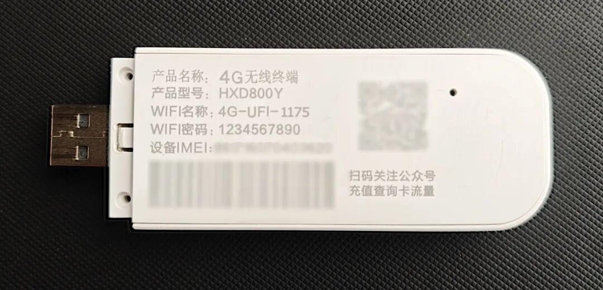
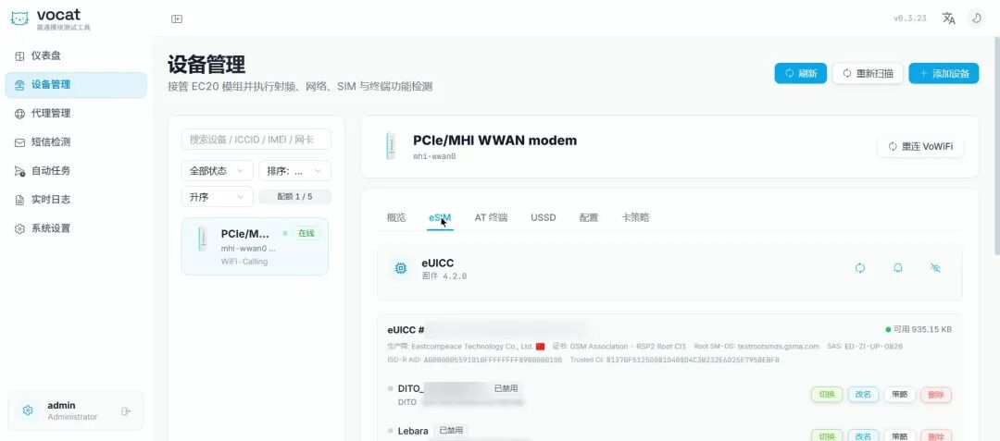
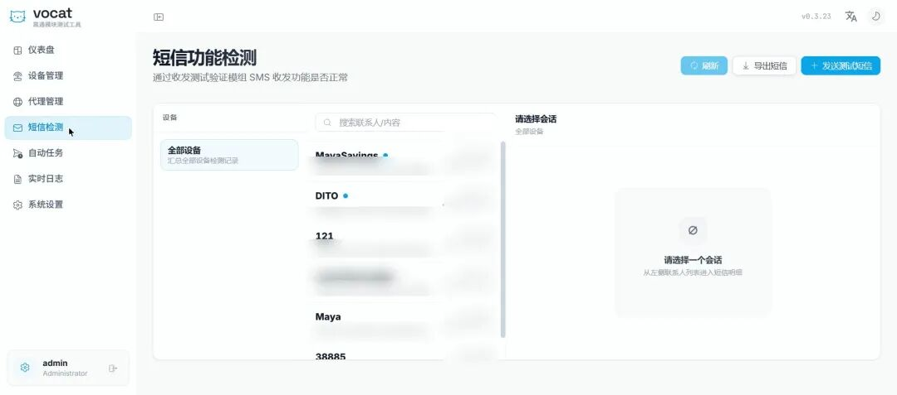
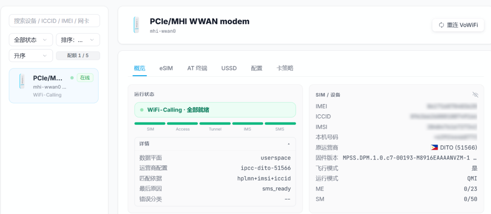
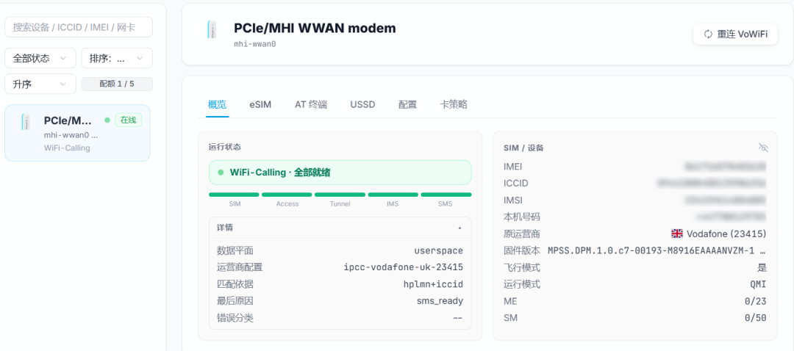
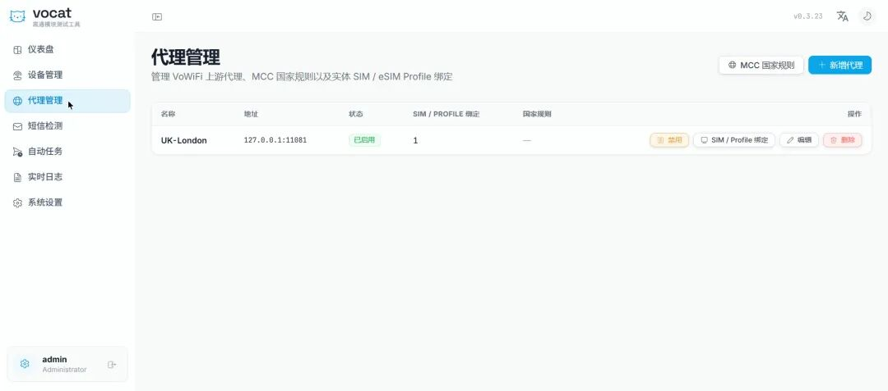
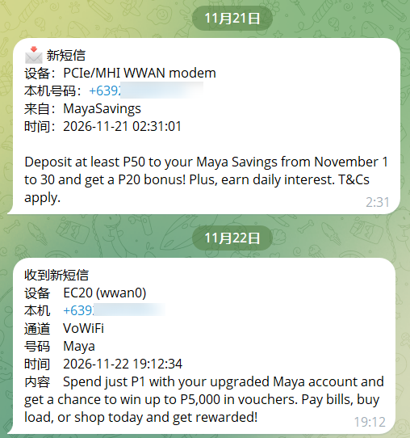
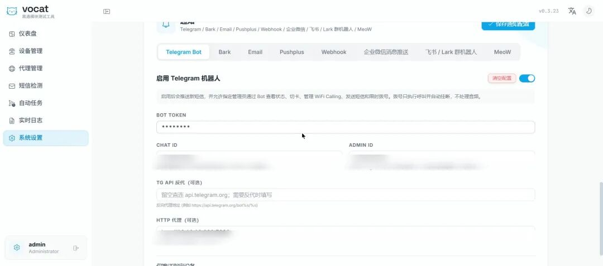

# WiFi Calling 保号神器：高通410随身WiFi 搭开源 VoCat，VOXI/Lebara 一键切卡 + 短信实时推 TG

> ✍️ **作者:** Today羊毛  
> 📅 **发布时间:** 2026/11/23 15:51:52  
> 🔗 **微信原文:** https://mp.weixin.qq.com/s/wAQuM-ccbIzznCoZIKTOeQ  
> 📦 **本地图片数:** 9 张 (已物理转存至本地 images/ 目录)

---


玩 4G 模组棒、随身 WiFi 的人都有这个痛点：模组插在棒子里，收个验证码短信、看眼信号、切张卡，要么敲 AT 命令，要么拔卡插回手机。**VoCat** 是 GitHub 上的一个开源项目，干的就是把这些事全搬进网页控制台。我正用一根高通 410 的随身 WiFi 棒子跑着它，这篇把项目本身、GitHub 上的近况和我这台的实际用法一起写清楚。

•**开源仓库地址**：https://github.com/MengMengCode/VoCat

## 01 项目概况（GitHub）

•**热度与维护**：2026 年 8 月开源，到我写这篇时已有 **1,356 个 Star、404 个 Fork、107 个 Release**，目前仍在高频活跃更新，不是那种发出来就没人管的仓库。
•**技术形态**：后端采用 Go，前端采用 React + TypeScript，生产版前端直接打包进 Go 二进制文件中——**一个可执行文件就是全部**，状态数据存在 SQLite 里。部署不用装数据库、不用配运行环境，这点对随身 WiFi 棒子这种小内存设备特别友好。
•**支持硬件（已核实）**：README 的官方支持名单是高通平台的移远 EC20、EC25、EG25 系列、EG600 兼容模组，以及中移 ML307 系列。名单也不是死的：2026 年 8 月合并的 PR #40 把模组发现逻辑从厂商白名单改成了识别 QMI 通道，还专门修复了高通 410 棒子的 AT 命令超时问题——SIMCom 等其他高通模组、PCIe/MHI 接口的模组都能被自动发现，我这根 410 棒子就是这么跑起来的。



我用的就是闲鱼上 20 元上下淘的高通 410 随身 WiFi，到手自己刷的系统，商家刷好的成品会稍微贵一些


闲鱼上随处可见的高通 410 棒子，价格非常便宜

•**安装方式**：支持一键脚本、手动放二进制、Docker（GHCR 镜像）三种方式，默认管理端口 **7575**，首次安装会自动生成管理员密码。一键安装命令如下：

```
"color:#6a9955"># root 用户（含 OpenWrt/Kwrt）：curl -fsSL https://raw.githubusercontent.com/MengMengCode/VoCat/master/scripts/install.sh | bash"color:#6a9955"># 普通用户（带 sudo 的发行版）：curl -fsSL https://raw.githubusercontent.com/MengMengCode/VoCat/master/scripts/install.sh | sudo bash"color:#6a9955"># Docker 镜像：docker pull ghcr.io/mengmengcode/vocat:latest
```

## 02 核心功能一览

•**设备管理**：支持串口 / USB 自动发现、多模组管理、设备改名、重启、飞行模式切换以及 USB 网络模式切换。



设备管理——设备详情的 eSIM 页：1 张 eUICC 装着多个 Profile，可随时切换（EID 与号码已打码）

•**无线与网络**：完整展示注册状态、运营商、RSRP / RSRQ / SINR 等信号指标、频段与信道信息，支持运营商扫描、自动 / 手动选网，甚至还能锁单个小区（EARFCN / PCI）。
•**AT 与 USSD**：内置网页版 AT 终端（带命令历史和原始回显）；USSD 支持发起、继续、取消的完整交互流程。
•**短信收发**：支持蜂窝短信和 IMS 短信双通道，收发、会话记录、送达报告、未读状态一应俱全。



短信检测——会话列表（手机号与短信内容已打码）

•**WiFi Calling（VoWiFi）**：支持 IKEv2 / ePDG 建隧道、EAP-AKA 鉴权、IMS 注册、IMS 短信以及按设备路由——**保号卡靠这个在没基站信号的地方也能稳收短信**。实测拉 VoWiFi 是一把好手：菲律宾 DITO、英国 VOXI 都能轻松拉起，连在手机上一直没拉起来的 Lebara 也能秒连。



菲律宾 DITO 卡：WiFi-Calling 全部就绪



英国 Vodafone / VOXI 系卡片：WiFi-Calling 同样秒级就绪

•**eSIM 管理**：支持 eUICC 自动发现、EID 与证书信息查看，以及 Profile 列表管理、启用 / 停用 / 切换、下载、改名与删除。
•**代理路由**：支持给 VoWiFi 挂载上游代理、按 SIM / Profile 单独绑定、配置 MCC 国家规则及连通性检查。代理这块对海外保号卡非常关键：有些卡的 WiFi Calling 要求出口 IP 必须在归属国，你可以给每张卡单独绑定一条对应国家的代理线路，多张卡、多条线路各走各的（多节点、单线路精准绑定）。



代理管理——UK-London 代理已启用，单独绑定 1 张 SIM 卡

## 03 推送通知：8 个渠道，Telegram 还能反向控制

这是我日常用得最多的部分，单独拎出来说。

入口在 **「系统设置 → 通知」**，可订阅的事件共 6 种：**设备上线、设备离线、任务开始、任务完成、任务失败、短信收到**。每个渠道都配有「测试通知」按钮，并且支持按设备过滤（只推指定设备）。

系统原生内置了 **8 个推送渠道**：Telegram、Bark、Email（SMTP）、Pushplus、Webhook、企业微信、飞书 / Lark 群机器人、MeoW。* 其中 **Webhook** 支持签名密钥、自定义请求头、文本模板和失败重试（默认超时 5 秒、重试 3 次）；* **企业微信和飞书**支持 JSON 模板，事件、标题、正文、ICCID 等变量都能直接套进去。

**Telegram 渠道最特别，它是双向交互的**：除了把新短信逐条实时推过来，还能直接通过 Bot **反向控制设备**——查状态、切卡、管理 WiFi Calling、发短信、限时拨号都可以。敏感操作会要求管理员二次确认，且只有填在 ADMIN ID 里的那个 Telegram 账号能下达命令，其他人发命令一概不认。对收验证码这个刚需场景来说，短信一到就自动转发到 Telegram，再也不用惦记着登网页控制台去看了。



Telegram 实时收到的菲律宾银行与运营商短信推送

我这台棒子的实际配置只开了 Telegram 一个渠道（Bot 走局域网里的 HTTP 代理出去，因为棒子本身直连 Telegram 不通），其余 7 个都没启用。短信会话里能清楚看到 DITO 和银行的通知短信，配合 Telegram 转发，菲律宾这张卡的验证码基本是实时到达手机。



通知设置——Telegram 渠道配置（ID 与代理地址已打码，BOT TOKEN 为页面自带掩码）

## 04 我这台的实际运行状态

•**硬件环境**：一根高通 410 的随身 WiFi（jz02v10 / msm8916，371MB 内存），自带实体 SIM 卡槽。VoCat 直接跑在棒子本机上，就这一台设备，没有外挂其他模组。
•**代理配置**：挂了 1 条出口在伦敦的上游代理专门给 VoWiFi 使用，MCC 国家规则暂时没配。

## 05 实用避坑与注意事项

1**WiFi Calling 依赖内核支持 XFRM / IPsec**：普通 Linux 发行版一般没问题；如果部署在 OpenWrt / Kwrt 上，要注意 fw4 防火墙可能会拦截 VoWiFi 隧道的入站连接，README 里有专门的说明和处理办法，安装前建议先看一眼。
2**Docker 部署权限较大**：官方 Docker 方式需要 host 网络 + 特权模式 + 挂载 /dev，这是为了发现模组与支持热插拔，建议只在自己可信的内网主机上这么跑。
3**面板切勿裸奔公网**：虽然系统有登录密码和 SSO，但面板背后握着发短信、切卡、拨号这些实打实的控制权，强烈建议只在内网或通过 VPN 访问，千万别把 7575 端口直接映射到公网。
4**收不到短信不一定是软件的锅**：社区 Issue 里有人反馈，某些保号卡在 IMS 显示注册成功的情况下却收不到验证码，把卡插回手机重新入网一次就恢复了，作者也建议优先走 WiFi Calling 通道。这类问题多半出在运营商侧的入网状态上，排查时先插回手机验证卡本身。
5**更新勤快，但版本跨度也大**：三个多月发了一百多个 Release，功能还在快速迭代中。升级前最好看一眼 Release 说明，主力运行的机器别开自动更新闷头往上升。

## 06 总结

VoCat 非常适合手里已经有高通 410 随身 WiFi、想远程收短信、玩 VoWiFi 保号、折腾 eSIM 切卡的玩家：一个单文件二进制加一个清爽网页，把原本散落在 AT 命令、零散脚本和反复拔卡插卡之间的活全收拢了，推送渠道还给得相当足。如果你已经在玩这类棒子，这个面板非常值得装上。

对我来说，它最大的价值就是**能在 Telegram 上直接切 eSIM、收短信**。场景非常具体：突然有个活动要用外卡接码，结果装着 eSIM 的手机没带在身上，或者插着实体小白卡的备用机没电了——这种时刻，高通 410 随身 WiFi 的优势就彻底体现出来了：只要棒子在线有网，人不管在哪，打开 Telegram 切个号，验证码直接秒推过来，真正实现随时随地切号收短信。

全文完

往期实测

01 越南 DataOnline 免费主机实测：1GB 空间 0 元开通，附续期避坑

02 Freehostia 免费主机教程：老牌免费空间，还能装 WordPress

03 Gemini 学生试用领取失败？问题出在 Play 支付资料的国家

关注「Today羊毛」，实测不迷路

免费主机 · 手机卡保号 · 网络福利，每篇都是自己上手测过的

觉得有用，点个 赞 和 在看，转给同样玩棒子的朋友

本文为个人实测记录，功能以 VoCat 官方仓库为准；管理面板请勿直接暴露在公网。

